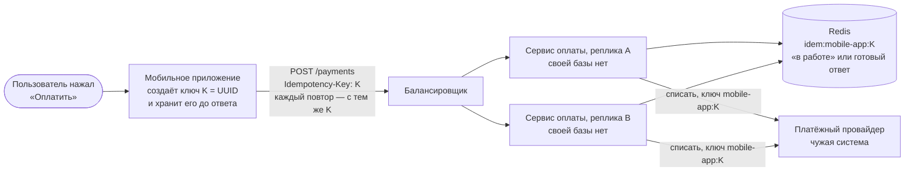
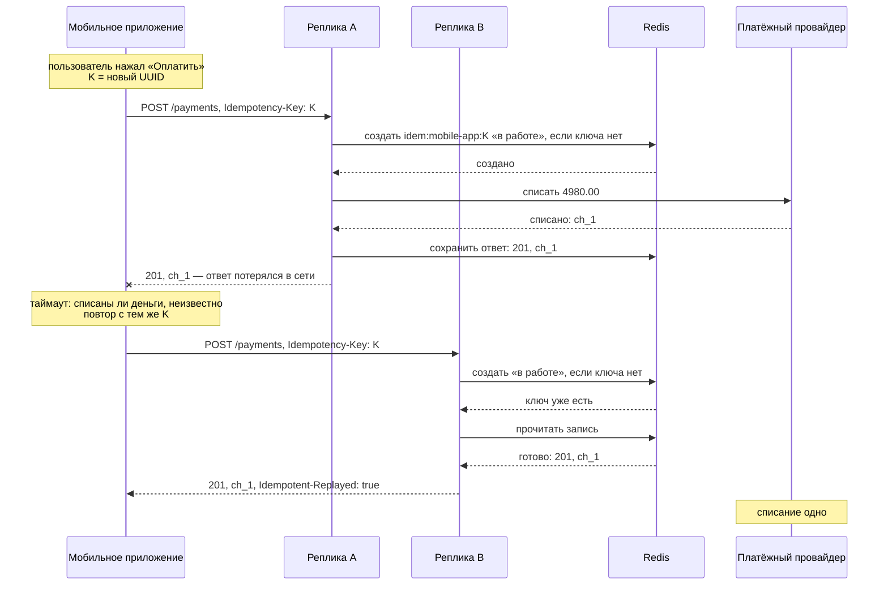
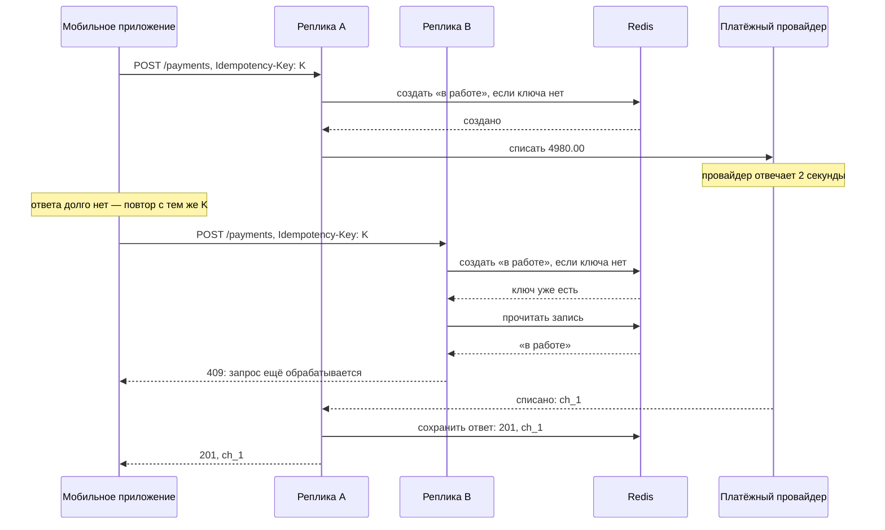
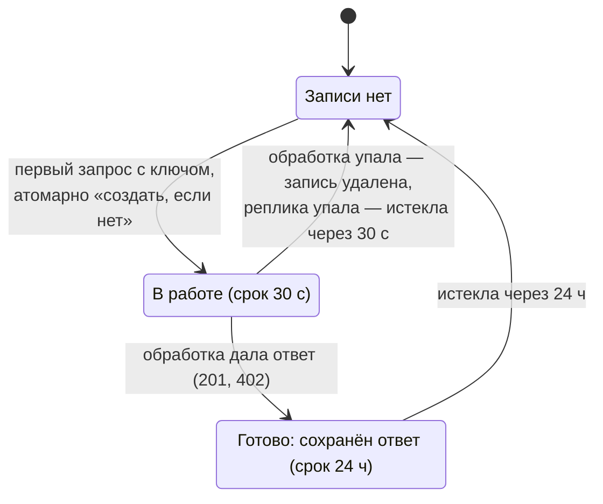
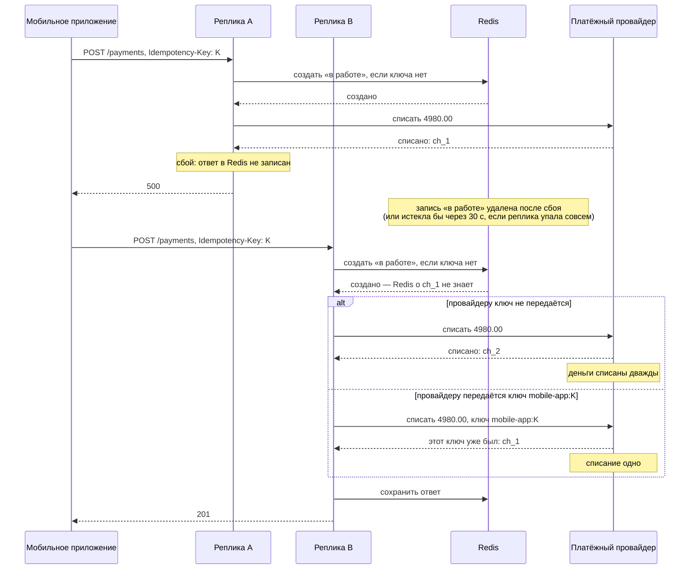

# Сценарий 4. Идемпотентность запросов: оплата через внешнего провайдера

Тест: `src/test/java/io/github/olaaa/redispatternslab/scenario/Scenario4IdempotencyTest.java`.
Ключи идемпотентности: `IdempotentRequests` (записи `idem:<клиент>:<ключ>` в Redis). Оплата: `PaymentController` (`POST /payments`), `PaymentService`. Платёжный провайдер: `PaymentProvider` — имитация внешней системы. Сбой для опыта: `PaymentFaults`. Настройки: `idempotency.in-progress-ttl` = 30 секунд, `completed-ttl` = 24 часа, `payments.provider-delay` = 2 секунды (в тестах — 300 мс), `payments.pass-key-to-provider` = true.
Ручная проверка: `http/04-idempotency.http` и команды `curl` ниже.

Коротко:

- **Что делаем.** Сервис оплаты списывает деньги за заказ через внешнего платёжного провайдера (банк-эквайер). Своей базы у сервиса нет.
- **Проблема.** Пользователь нажал «Оплатить» один раз. Деньги списаны, а ответ до телефона не дошёл: лифт, смена Wi‑Fi на LTE, таймаут. Приложение не знает, прошла ли оплата, и повторяет запрос. Без защиты деньги спишутся дважды.
- **Ключ идемпотентности.** Приложение создаёт ключ (UUID) в момент нажатия «Оплатить» и шлёт его в заголовке `Idempotency-Key` с каждым повтором этой оплаты. Сервис выполняет оплату с этим ключом один раз, повторам отдаёт сохранённый ответ.
- **Можно ли без Redis.** Можно, если провайдер сам принимает ключ идемпотентности: тогда ключ пробрасывается от приложения до провайдера, и двойного списания не будет. Redis — общий для реплик слой перед провайдером: повторы получают ответ сразу и до провайдера не доходят, а правила повторов — сроки и коды ответов — свои, а не провайдера. Подробно — раздел «Можно обойтись без Redis: ключ до самого провайдера».
- **Предел Redis.** Если реплика упала после списания, но до записи ответа в Redis, повтор спишет второй раз. Это закрывает только сам провайдер: ему тоже передают ключ идемпотентности.

## Общая картина



Кто где стоит:

- **Мобильное приложение** создаёт ключ и повторяет запрос с ним. Сервер ключей не выдаёт, он их только запоминает.
- **Реплики сервиса оплаты** — любая может получить и первый запрос, и повтор: балансировщик не знает, что запрос повторный. Своей базы у сервиса нет, а в памяти реплики помнить ключи нельзя: повтор придёт на другую реплику, перезапуск сотрёт память.
- **Redis** хранит запись о ключе `idem:<клиент>:<ключ>`: «в работе» или «готово» с сохранённым ответом. Через неё реплика B узнаёт, что реплика A этот платёж уже провела.
- **Платёжный провайдер** — чужая система, в ней и происходит действие: списание денег. Сервис передаёт ему свой ключ `<клиент>:<ключ>`, и провайдер не спишет дважды с одним ключом.

В коде запрос проходит так:

1. `PaymentController` берёт заголовок `Idempotency-Key`, тело и `X-Client-Id`. Нет ключа — 400.
2. `IdempotentRequests.execute(клиент, ключ, отпечаток тела, «оплатить»)` по записи в Redis решает: выполнять или ответить без выполнения.
3. Если выполнять — `PaymentService.pay` вызывает провайдера.
4. `IdempotentRequests` сохраняет ответ в Redis и отдаёт его клиенту.

## Где помнить ключи

Сравним с запросом, который меняет только нашу базу. Если бы оплата была записью в нашей таблице платежей, хватило бы уникального ключа в той же таблице: вставка с ключом и проверка «такой уже есть» — одна операция в одной транзакции. Так и предлагает Брандур Лич в статье «Implementing Stripe-like Idempotency Keys in Postgres» (2017): если запрос меняет только данные в одной базе с ACID, проще обойтись её транзакциями, а ключи и сохранённые ответы держать в той же базе.

Здесь так не выйдет:

- **Своей базы у сервиса нет.** Вся его работа — вызов провайдера.
- **Действие происходит в чужой системе.** Положить уникальный ключ в базу провайдера нельзя, общей транзакции с ним нет. Брандур называет такие действия изменениями чужого состояния (foreign state mutations): после первого такого вызова, пишет он, мы уже связаны его результатом, каким бы он ни был.

Значит, если помнить ключи на своей стороне, то в отдельном хранилище, общем для всех реплик. Можно завести базу только ради ключей, но Redis подходит для этой роли лучше:

- **Быстро.** Проверка и запись — доли миллисекунды на каждом запросе оплаты.
- **Срок хранения сам собой.** Запись «в работе» живёт 30 секунд, готовый ответ — 24 часа; потом Redis удаляет их сам. В базе для этого нужна отдельная задача очистки.
- **Атомарно.** «Создать запись, только если ключа нет» — один Lua-скрипт, и два одновременных повтора не вызовут провайдера оба.

**Чего Redis не даёт.** Запись в Redis и списание у провайдера — две разные операции в двух разных системах. Если между ними реплика упала, Redis не узнает о списании, и повтор спишет второй раз. Это закрывает только ключ, переданный самому провайдеру: провайдер узнаёт его и возвращает прежнее списание. Stripe принимает ключ идемпотентности ровно для этого. Подробно — раздел «Предел Redis: сбой после списания».

| | Redis | Ключ у провайдера |
|---|---|---|
| От чего защищает | от повтора после ответа — повтор получает сохранённый ответ, до провайдера не доходит; от повтора, пока первый в работе — 409 | от второго списания, когда Redis о первом не знает |
| Когда без него плохо | без него каждый повтор идёт к провайдеру; если провайдер ключей не принимает — каждый повтор списывает деньги | без него сбой между списанием и записью в Redis даёт двойное списание |

## Можно обойтись без Redis: ключ до самого провайдера

Если провайдер принимает ключ идемпотентности, как Stripe, ключ можно пробросить от браузера или мобильного приложения до самого провайдера, и это будет работать без Redis:


Сервис ничего не запоминает, а только передаёт ключ дальше. Всё, что делает наш слой в Redis, провайдер умеет и сам:

| Случай | Наш слой в Redis | Провайдер с ключом, на примере Stripe |
|---|---|---|
| повтор после списания | сохранённый ответ | результат первого запроса; ключи хранятся не меньше 24 часов |
| повтор, пока первый ещё идёт | 409 | ошибка `idempotency_key_in_use`: ключ «сейчас используется в другом запросе» |
| тот же ключ, другие параметры | 422 | ошибка: параметры сравниваются с исходными |
| сбой после списания | не помогает | закрывает |

Что сервис всё же должен сделать — добавить к ключу клиента префикс: передавать `<клиент>:<ключ>`, а не голый ключ. У сервиса один счёт у провайдера, и ключи всех клиентов там лежат вместе: без префикса два клиента со случайно одинаковыми ключами получили бы одно списание на двоих. Префикс состояния не требует.

Тест `crashAfterChargeWithKeyForProviderChargesOnce` это и показывает: запись в Redis удалена, повтор доходит до провайдера, и от второго списания спасает его ключ, а не Redis.

**Но с Redis лучше, потому что:**

- **Повтор отвечает сразу.** Ответ берётся из Redis, провайдер не вызывается. В лаборатории провайдер отвечает 2 секунды, а повтор из Redis — сразу; тест `retryWithSameKeyGetsSavedResponseAndChargesOnce`: провайдер вызван один раз на два запроса.
- **Меньше нагрузки на провайдера.** Повторы приходят пачками как раз тогда, когда сеть сбоит, а у провайдера свои ограничения частоты запросов — у Stripe на их превышение есть ошибка `rate_limit`. С Redis повторы до провайдера не доходят и его лимиты не тратят.
- **Правила повторов свои, а не провайдера.** Сколько хранятся ключи, что отвечать на одновременный повтор, сравнивать ли параметры — без Redis это решает провайдер, и у каждого провайдера по-своему: у Stripe ключи живут не меньше 24 часов, у другого срок может быть меньше или не опубликован. С Redis клиент видит один и тот же контракт — 409, 422, сутки, `Idempotent-Replayed: true` — и при смене провайдера он не меняется.
- **Повтор получает наш ответ слово в слово.** Без Redis повтор заново проходит весь наш код после вызова провайдера: если ответ собирается из данных других сервисов или зависит от времени, ответ на повтор может отличаться от первого. С Redis отдаётся сохранённый ответ.
- **Защита не привязана к одному провайдеру.** Ключ у провайдера защищает только внутри этого провайдера. Если сервис при таймауте переключается на запасного эквайера, ключ первого запасному неизвестен; запись «в работе» в Redis не даст повтору уйти к запасному, пока первый запрос ещё идёт. Это вывод из устройства, в лаборатории не проверялся; после сбоя реплики запись удаляется, и тогда эта защита не работает.

**Цена Redis** — ещё одна система на пути каждой оплаты. Если Redis недоступен, нужно решить: отказывать в оплате или пропускать запрос к провайдеру, полагаясь на его ключ. В лаборатории этот случай не разбирается.

**Когда без хранилища ключей не обойтись.** Когда повтор не может отсечь никто, кроме нас: своей базы нет, а внешняя система ключей не принимает — SMS-шлюз, отправка писем, push-уведомления, старый партнёрский API. Тогда общее для реплик хранилище ключей — единственная защита от повторов. Буквально «без Redis» и тут обойтись можно: ключи можно держать в отдельной таблице Postgres, а Redis удобен скоростью, сроком хранения и атомарностью. И окно сбоя остаётся: если реплика выполнила действие и упала до записи ответа, повтор выполнит его снова — внешняя система этот ключ не знает.

## Откуда берётся ключ и когда второй запрос вообще появляется

**Откуда второй запрос.** Пользователь нажимает «Оплатить» один раз. Второй запрос появляется не от второго нажатия, а потому что приложение не узнало, чем кончился первый:

| Время | Что происходит |
|---|---|
| 12:00:00.000 | пользователь нажал «Оплатить», приложение отправило `POST /payments` |
| 12:00:02.000 | провайдер списал 4980.00, сервис сохранил ответ и отправил 201 |
| 12:00:02.010 | телефон в лифте или переключается с Wi‑Fi на LTE — ответ не дошёл |
| 12:00:10.000 | у приложения истёк таймаут: «Не удалось оплатить. Повторить?» |
| 12:00:12.000 | пользователь нажимает «Повторить» или приложение повторяет само — второй `POST /payments` |

По таймауту приложение не может отличить «запрос не дошёл» (денег не списали, повторять нужно) от «ответ не дошёл» (деньги списаны, повторять нельзя). Ключ идемпотентности делает повтор безопасным в обоих случаях. Другие пути к повтору: сервис отвечает дольше таймаута приложения, двойное касание кнопки, повтор, настроенный в балансировщике или клиентской библиотеке.

**Откуда ключ.** Ключ создаёт приложение, потому что только оно знает, что два запроса — одна и та же оплата. По телу запроса сервис этого не отличит: оплата того же заказа на ту же сумму и повтор выглядят одинаково.

| Что происходит в приложении | Что оно шлёт в `Idempotency-Key` |
|---|---|
| пользователь нажал «Оплатить» — первая отправка | новый ключ K1 (UUID), приложение запоминает его |
| ответа нет: таймаут, обрыв сети, ответ 409 или 5xx — повтор | тот же K1 |
| пришёл окончательный ответ — 201, 402, 422 | K1 больше не нужен |
| пользователь оплачивает другой заказ | новый ключ K2 |

**Когда заголовка нет.** Только если клиент его не прислал. Для оплаты это опасно, поэтому заголовок обязателен: без него — 400. Черновик IETF так и советует: если ключ обязателен, а его нет, сервер «должен ответить кодом 400».

## Как ещё называют заголовок с ключом

Чаще всего — `Idempotency-Key`: это имя закрепляет черновик IETF, его используют Stripe и Adyen (в документации Adyen — `idempotency-key` строчными; это тот же заголовок, имена заголовков HTTP не различают регистр). У многих провайдеров имя своё, а кто-то передаёт ключ не в заголовке, а в самом запросе.

| Где | Имя | Где передаётся |
|---|---|---|
| черновик IETF, Stripe, Adyen | `Idempotency-Key` | заголовок |
| PayPal | `PayPal-Request-Id` | заголовок |
| Checkout.com | `Cko-Idempotency-Key` | заголовок |
| Amazon Pay | `x-amz-pay-idempotency-key` | заголовок |
| Worldline | `X-GCS-Idempotence-Key` | заголовок |
| ЮKassa | `Idempotence-Key` | заголовок; по русскоязычной странице документации — английская версия не открылась |
| спецификация OASIS Repeatable Requests, например Azure Communication Services | `Repeatability-Request-ID` и `Repeatability-First-Sent` | два заголовка |
| Square | `idempotency_key` | поле тела запроса, обязательное |
| AWS, например EC2 | `ClientToken`; в AWS CLI — `--client-token` | параметр запроса |
| Google, рекомендации AIP-155 | `request_id` | поле сообщения запроса |

Встречаются оба написания: Idempotency и Idempotence.

**Пара заголовков OASIS.** `Repeatability-Request-ID` — уникальный GUID запроса, `Repeatability-First-Sent` — когда исходный запрос отправили впервые, в UTC. В Azure Communication Services запросы отслеживаются 5 минут; если время первой отправки старше, повторять запрос небезопасно, и сервис отвечает 412.

### `*-Request-ID`: ключ идемпотентности или трассировка

Под именем `*-Request-ID` встречаются два разных заголовка, и по имени их не различить.

- **`PayPal-Request-Id`, `Repeatability-Request-ID` — ключи идемпотентности.** Клиент создаёт значение один раз на операцию и шлёт его со всеми повторами; сервер запоминает его и второй раз операцию не выполняет. По документации PayPal, заголовок содержит уникальный идентификатор, созданный клиентом, и сервер хранит его какое-то время.
- **`X-Request-ID` — обычно трассировка.** Он связывает записи логов разных систем об одном запросе. Маршрутизатор Heroku создаёт уникальный `X-Request-ID` для каждого входящего запроса и передаёт его приложению, чтобы строку его лога найти в логах приложения. В nginx есть переменная `$request_id` — уникальный идентификатор запроса из 16 случайных байт; её часто ставят в такой заголовок. Отсюда вывод: каждая попытка получает новый идентификатор, повтор по нему не узнать, и от второго списания он не защищает.

| | Ключ идемпотентности | Идентификатор для трассировки |
|---|---|---|
| Кто создаёт | клиент, один раз на операцию | клиент или прокси, часто на каждую попытку |
| У повтора | то же значение | обычно новое |
| Что с ним делает сервер | хранит и по нему отсекает повтор | пишет в логи |
| Примеры | `Idempotency-Key`, `PayPal-Request-Id`, `Repeatability-Request-ID` | `X-Request-ID`, `X-Correlation-ID` |

Встретив `*-Request-ID` в проекте, по имени не понять, что это: надо смотреть, что с ним делает сервер — сохраняет и отсекает по нему повторы или только пишет в логи.

## Как проходят запрос и повтор

Главный случай — ответ потерялся:



Повтор попал на другую реплику — неважно: запись о ключе в Redis общая. Реплика B провайдера не вызывает, а отдаёт ответ, который сохранила реплика A, слово в слово, и заголовком `Idempotent-Replayed: true` говорит клиенту, что это повтор.

## Повтор, пока первый запрос ещё в работе



Повтор получает 409 и провайдера не вызывает. 409 не сохраняется: это не результат оплаты, а «подождите». Клиент повторит позже и получит сохранённый 201.

## Состояния записи о ключе



- **«В работе»** живёт 30 секунд. Если реплика упала посреди обработки, удалить запись некому — через 30 секунд она истечёт, и повтор сможет выполниться.
- **«Готово»** живёт 24 часа. Всё это время повторы получают сохранённый ответ. Через сутки запись исчезает, и тот же ключ провёл бы новую оплату — поэтому клиент не должен повторять дольше суток.

## Как устроено в Redis

Запись о ключе — хеш `idem:<клиент>:<ключ>`:

| Поле | Значение |
|---|---|
| `state` | `IN_PROGRESS` — в работе, `COMPLETED` — ответ готов |
| `token` | случайная строка той реплики, что обрабатывает |
| `fingerprint` | отпечаток тела запроса: SHA-256 от заказа и суммы |
| `status`, `body` | сохранённый ответ |

**Начать** — Lua-скрипт атомарно проверяет, что ключа нет, и создаёт запись «в работе»:

```lua
if redis.call('EXISTS', KEYS[1]) == 1 then
    return 0
end
redis.call('HSET', KEYS[1], 'state', 'IN_PROGRESS', 'token', ARGV[1], 'fingerprint', ARGV[2])
redis.call('PEXPIRE', KEYS[1], ARGV[3])
return 1
```

Проверка и запись — одним скриптом: иначе два одновременных повтора оба увидели бы «ключа нет» и оба вызвали бы провайдера. Это то же «взять, если свободно», что `SET NX` в блокировке сценария 3.

**Получилось** — вызвать провайдера и сохранить ответ: запись становится «готово» на 24 часа. Сохраняет только та реплика, чей `token` в записи.

**Ключ уже есть** — прочитать запись и ответить по ней:

| Что в записи | Ответ |
|---|---|
| другой отпечаток | 422: тот же ключ с другим запросом |
| «в работе» | 409: первый запрос ещё обрабатывается |
| «готово» | сохранённый ответ и `Idempotent-Replayed: true`; провайдер не вызывается |

**Какие ответы сохраняются.** Всё, что дала обработка: 201 со списанием и 402, если провайдер отказал (тест `declinedPaymentIsSavedAndReplayed`). Если обработка упала с исключением, запись удаляется, и повтор выполнится заново.

## Предел Redis: сбой после списания



Реплика A списала деньги и упала, не записав ответ. Запись «в работе» удалена — или истекла бы через 30 секунд. Повтор на реплике B начинает всё заново: Redis о списании не знает. Дальше всё зависит от провайдера:

- **Ключ провайдеру не передаётся** — он списывает второй раз. Тест `crashAfterChargeWithoutKeyForProviderChargesTwice`.
- **Ключ передаётся** (`<клиент>:<ключ>`) — провайдер узнаёт его и возвращает прежнее списание `ch_1`. Тест `crashAfterChargeWithKeyForProviderChargesOnce`: два вызова провайдера, одно списание.

Отсюда правило: Redis отсекает повторы до вызова провайдера и хранит ответ, но окончательная защита — там, где происходит действие. Если провайдер ключей не принимает, остаётся сверка: спросить у провайдера, было ли списание по этому заказу, прежде чем списывать снова. Это вывод из устройства, в лаборатории не реализовано.

## Что говорят стандарт и Stripe

- **Черновик IETF** `draft-ietf-httpapi-idempotency-key-header-08` (октябрь 2026). Ключ создаёт клиент; «уникальность ключа должен определить владелец ресурса, а соблюдать — клиенты» — здесь ключ уникален в пределах клиента. Отпечаток «можно использовать вместе с ключом идемпотентности, чтобы определить уникальность запроса». Коды: без ключа, где он обязателен, — 400; тот же ключ с другим телом — 422; повтор, пока исходный запрос обрабатывается, — 409. Срок хранения ключей сервер определяет сам и публикует.
- **Stripe.** Ключ идемпотентности нужен, чтобы «повторять запрос безопасно, без риска создать второй объект или выполнить обновление дважды». Ключ — UUID версии 4 или другая случайная строка. Сохраняется код и тело ответа первого запроса, после того как обработка началась; если параметры не прошли проверку или запрос столкнулся с одновременным, результат не сохраняется. Ключи удаляются не раньше чем через 24 часа. Входящие параметры сравниваются с исходными.
- **RFC 9110**, раздел 9.2.2: метод «считается идемпотентным, если ожидаемый результат нескольких одинаковых запросов на сервере тот же, что и у одного такого запроса». `POST` не идемпотентен, и «клиенту не следует автоматически повторять запрос с неидемпотентным методом, если у него нет способа узнать, что запрос на самом деле идемпотентен, или способа обнаружить, что исходный запрос не был выполнен». Ключ идемпотентности — такой способ.

## Что проверяют тесты

`retryWithoutIdempotencyChargesTwice`: два вызова сервиса оплаты без слоя идемпотентности — два списания.

`paymentWithoutKeyIsRejected`: оплата без заголовка — 400, провайдер не вызывался.

`retryWithSameKeyGetsSavedResponseAndChargesOnce` (через HTTP): первый ответ 201, повтор — тот же ответ слово в слово и `Idempotent-Replayed: true`; провайдер вызван один раз.

`retryWhileFirstIsInProgressGetsConflict`: пока первый запрос у провайдера, повтор получает 409; после — сохранённый ответ; провайдер вызван один раз.

`sameKeyWithDifferentRequestIsRejected`: тот же ключ, другая сумма — 422.

`declinedPaymentIsSavedAndReplayed`: отказ провайдера (402) сохранён и повторён без нового вызова.

`crashAfterChargeWithoutKeyForProviderChargesTwice`: сбой после списания, ключ провайдеру не передаётся — повтор списывает второй раз.

`crashAfterChargeWithKeyForProviderChargesOnce`: то же, но ключ передаётся — провайдер возвращает прежнее списание, оно одно.

`keyHeldByCrashedReplicaFreesAfterInProgressTtl`: запись «в работе» от упавшей реплики — 409, пока не истекла, потом оплата проходит один раз.

`sameKeyFromDifferentClientsChargesTwice`: одинаковый ключ у двух клиентов — два разных платежа.

`completedRecordKeepsResponseForDay`: после ответа запись — «готово» со статусом 201, срок — больше 23 и не больше 24 часов.

Весь набор тестов лаборатории, 31 тест, прогнан три раза подряд без падений.

## Попробовать вручную

Запустить приложение: `mvn spring-boot:run`. Провайдер отвечает 2 секунды — за это время можно успеть повторить запрос.

```bash
H=localhost:8080
J='Content-Type: application/json'
B='{"orderId":"order-42","amount":4980.00}'
F='HTTP %{http_code} replayed=%header{idempotent-replayed}\n'
curl -s -X POST $H/lab/reset

# без ключа
curl -s -w "\n$F" -X POST -H "$J" -H 'X-Client-Id: mobile-app' -d "$B" $H/payments

# с ключом: первый, повтор, пока он в работе, повтор после, другая сумма
curl -s -w "\n$F" -X POST -H "$J" -H 'X-Client-Id: mobile-app' -H 'Idempotency-Key: pay-1' -d "$B" $H/payments &
sleep 0.5
curl -s -w "\n$F" -X POST -H "$J" -H 'X-Client-Id: mobile-app' -H 'Idempotency-Key: pay-1' -d "$B" $H/payments
wait
curl -s -w "\n$F" -X POST -H "$J" -H 'X-Client-Id: mobile-app' -H 'Idempotency-Key: pay-1' -d "$B" $H/payments
curl -s -w "\n$F" -X POST -H "$J" -H 'X-Client-Id: mobile-app' -H 'Idempotency-Key: pay-1' -d '{"orderId":"order-42","amount":9960.00}' $H/payments
curl -s $H/lab/payments/provider

# сбой после списания: ключ провайдеру передаётся
curl -s -X POST "$H/lab/payments/fail-after-charge?enabled=true"
curl -s -o /dev/null -w "$F" -X POST -H "$J" -H 'X-Client-Id: mobile-app' -H 'Idempotency-Key: pay-2' -d '{"orderId":"order-43","amount":1200.00}' $H/payments
curl -s -X POST "$H/lab/payments/fail-after-charge?enabled=false"
curl -s -w "\n$F" -X POST -H "$J" -H 'X-Client-Id: mobile-app' -H 'Idempotency-Key: pay-2' -d '{"orderId":"order-43","amount":1200.00}' $H/payments
curl -s $H/lab/payments/provider
```

Результат такого прогона (тела сокращены):

```text
без ключа:                 HTTP 400, «нужен заголовок Idempotency-Key»
с ключом, в работе:        HTTP 409, «запрос с этим ключом идемпотентности ещё обрабатывается»
с ключом, первый:          HTTP 201, ch_1, order-42, 4980.00
с ключом, повтор:          HTTP 201 replayed=true, ch_1 — то же списание
с ключом, другая сумма:    HTTP 422, «ключ идемпотентности уже использован с другим запросом»
провайдер:                 calls 1, списание одно — ch_1
сбой после списания:       HTTP 500
повтор после сбоя:         HTTP 201, ch_2, order-43, 1200.00
провайдер:                 calls 3, списаний два — ch_1 и ch_2, по одному на каждую оплату
```

После сбоя провайдер вызван второй раз (calls 3), но нового списания нет: он узнал ключ `mobile-app:pay-2` и вернул `ch_2`. В `http/04-idempotency.http` — те же запросы для IntelliJ HTTP Client. Чтобы увидеть двойное списание, приложение можно запустить с `--payments.pass-key-to-provider=false`.

## Что важно заметить

- Второй запрос появляется не от второго нажатия, а потому что клиент по таймауту не знает, дошёл ли ответ.
- Ключ создаёт клиент и повторяет его со всеми повторами одной операции. Сервис выполняет операцию один раз, повторам отдаёт сохранённый ответ.
- Помнить ключи нужно в хранилище, общем для всех реплик. Если действие — изменение в нашей базе, ключ кладут туда же, в ту же транзакцию. Если базы нет, а действие во внешней системе, которая принимает ключ, — можно пробросить ключ до неё и обойтись без Redis; Redis перед ней отсекает повторы и делает правила повторов своими. Если внешняя система ключей не принимает — без отдельного хранилища ключей не обойтись.
- Начало обработки — атомарное «создать, если нет»: иначе одновременные повторы выполнятся оба.
- Redis не атомарен с внешним вызовом: между списанием и записью ответа реплика может упасть. Окончательная защита — ключ, переданный во внешнюю систему.

## Как сказать на собеседовании

«Оплата через внешнего провайдера — классический случай для ключа идемпотентности: клиент по таймауту не знает, списаны ли деньги, и повторяет. Клиент генерирует UUID при нажатии "Оплатить" и шлёт его со всеми повторами; без ключа — 400. Если провайдер принимает ключ, можно обойтись и без Redis — пробросить ключ до провайдера с префиксом клиента. Но я ставлю перед ним Redis, чтобы повторы отвечали сразу, не тратили лимиты провайдера и подчинялись моим правилам, а не его: Lua-скриптом атомарно создаю запись "в работе" с отпечатком тела и коротким сроком, после ответа провайдера сохраняю ответ на сутки. Повтор получает сохранённый ответ, пока первый в работе — 409, с другим телом — 422. Но Redis и провайдер — разные системы: если реплика упала между списанием и записью в Redis, повтор спишет второй раз. Поэтому ключ передаю и провайдеру — Stripe его принимает. А если бы действие было записью в нашей базе, обошёлся бы без Redis: уникальный ключ в той же таблице, в той же транзакции».

## Источники

- RFC 9110 — [HTTP Semantics](https://www.rfc-editor.org/rfc/rfc9110#section-9.2.2), раздел 9.2.2 «Idempotent Methods».
- IETF — [The Idempotency-Key HTTP Header Field](https://datatracker.ietf.org/doc/draft-ietf-httpapi-idempotency-key-header/), `draft-ietf-httpapi-idempotency-key-header-08`.
- Stripe — [Idempotent requests](https://docs.stripe.com/api/idempotent_requests).
- Stripe — [Error codes](https://docs.stripe.com/error-codes), `idempotency_key_in_use` и `rate_limit`.
- Brandur Leach — [Implementing Stripe-like Idempotency Keys in Postgres](https://brandur.org/idempotency-keys), 2017.
- Adyen — [API idempotency](https://docs.adyen.com/development-resources/api-idempotency).
- PayPal — [Idempotency](https://developer.paypal.com/api/rest/reference/idempotency/).
- Checkout.com — [Idempotency](https://www.checkout.com/docs/developer-resources/api/idempotency).
- Amazon Pay — [Idempotency](https://developer.amazon.com/docs/amazon-pay-api-v2/idempotency.html).
- Worldline Direct — [Idempotent requests](https://docs.direct.worldline-solutions.com/integration/api-developer-guide/idempotent-requests).
- ЮKassa — [Формат взаимодействия](https://yookassa.ru/developers/using-api/interaction-format), русскоязычная страница: английская версия не открылась.
- Microsoft — [Repeatable requests](https://learn.microsoft.com/en-us/rest/api/communication/repeatable-requests), Azure Communication Services; OASIS — [Repeatable Requests Version 1.0](https://docs.oasis-open.org/odata/repeatable-requests/v1.0/repeatable-requests-v1.0.html).
- Square — [CreatePayment](https://developer.squareup.com/reference/square/payments-api/create-payment).
- AWS — [Ensuring idempotency in Amazon EC2 API requests](https://docs.aws.amazon.com/ec2/latest/devguide/ec2-api-idempotency.html).
- Google — [AIP-155 Request identification](https://google.aip.dev/155).
- Heroku — [HTTP Request IDs](https://devcenter.heroku.com/articles/http-request-id).
- nginx — [ngx_http_core_module, `$request_id`](https://nginx.org/en/docs/http/ngx_http_core_module.html#var_request_id).
